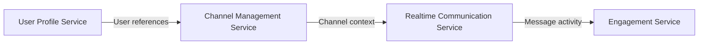

# Bizcord microservice design

This is the design from our week 36 workshop, updated to reflect the User Profile service we have built. Bizcord is a Discord-like communication system. We divided its backend into four services, with each service responsible for its own part of the system.

## Services and data ownership

**User Profile Service** manages user profile information such as display names and bios. It owns the profile records and a local summary of each user's message activity. The activity summary comes from message events; the actual messages belong to Realtime Communication.

**Channel Management Service** manages channels and their memberships. It owns channel details and membership records. It refers to users by ID rather than maintaining its own copies of their profiles.

**Realtime Communication Service** handles messages sent in channels. It owns message content, authorship, channel references and posting times. It uses channel information without taking ownership of the channels.

**Engagement Service** covers reactions and notifications triggered by user activity. It owns the reaction and notification data, not the messages or user profiles that those records refer to.

These boundaries let each service change its own data without directly modifying another service's records.

## Service interactions

Our workshop design identified the following main relationships:

These are the main dependencies in the overall design, not a claim that every interaction is running today. Services can use REST when they need current information from another service, and messaging when they need to react to an event.

The User Profile service exposes profile information through its REST API. It also subscribes to `MessagePostedEvent` through RabbitMQ. When a message event arrives, the service updates the author's local message count and last message time, then publishes `UserProfileActivityUpdatedEvent`. The result includes the original `MessageId` so the events can be linked.

Only the User Profile service is implemented in this repository. The other three services and their interactions remain part of the wider Bizcord design. Profile data and message activity are currently stored in memory, so they are cleared when the service restarts.
